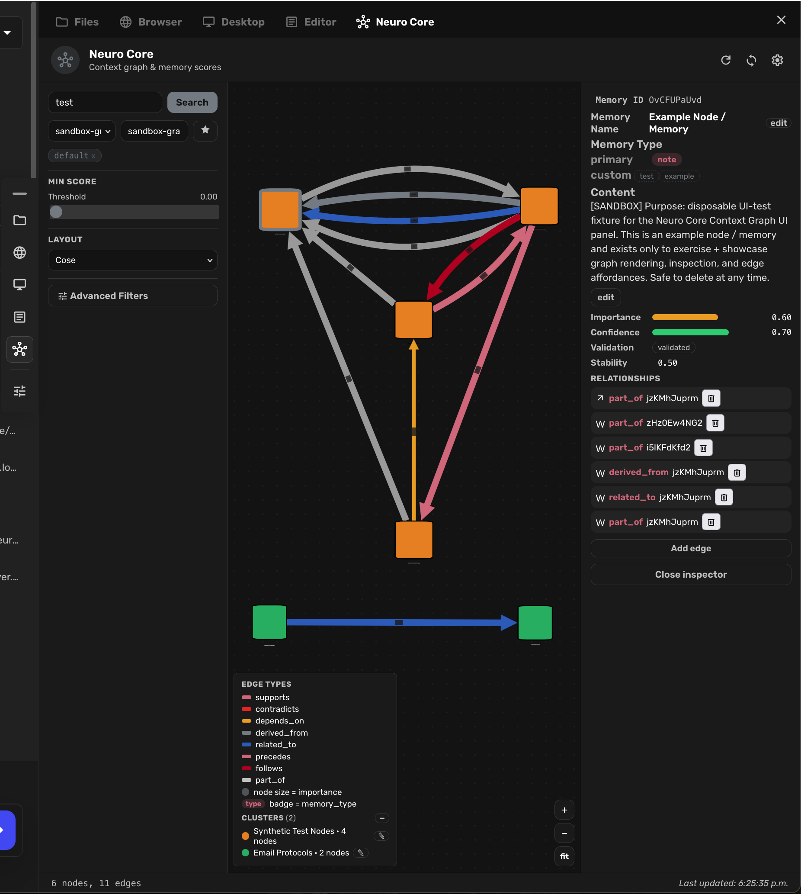
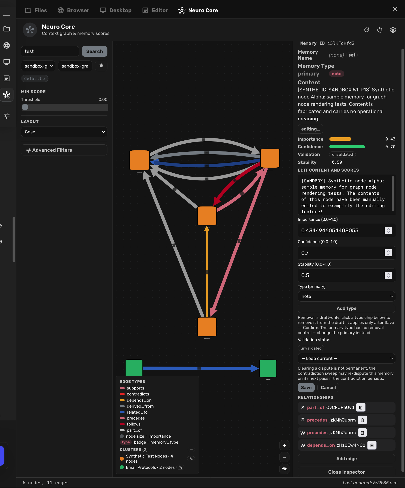
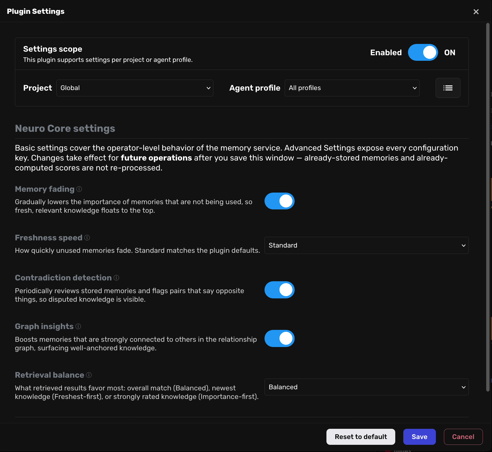
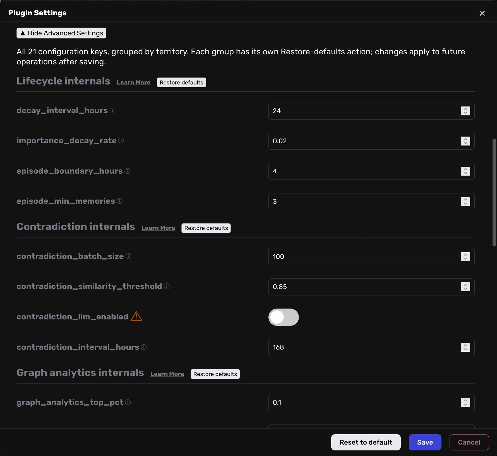
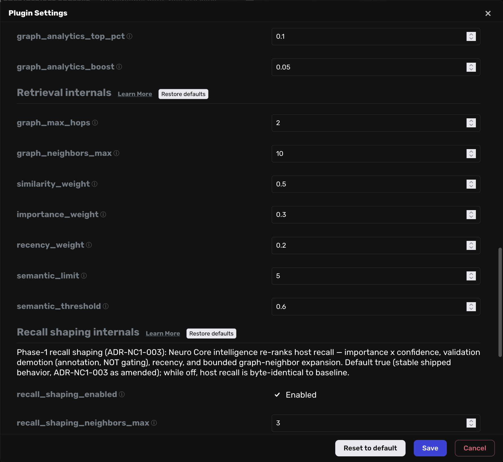

<div align="center">

# Neuro Core

### Explainable, scoped memory for your agents.

Neuro Core extends Agent Zero's built-in memory with typed categories, a
relationship graph, importance scoring, lifecycle maintenance, and a
visual Context Graph that shows **why** every memory ranked where it did.

[](tests/)
[](LICENSE)
[](https://github.com/agent0ai/agent-zero)
[](CHANGELOG.md)

[Quick Start](#quick-start) | [Features](#why-neuro-core) | [How It Works](#how-it-works) | [Documentation](#documentation)

</div>

---

<div align="center">



*The Context Graph panel — every node is a memory; every edge is a typed relationship; the inspector explains the ranking factors.*

</div>

# Why Neuro Core

| Feature | Why it matters |
| --- | --- |
| **Explainable retrieval** | Every retrieved memory carries its ranking factors — similarity, importance, confidence, recency — as data you can inspect, not a black-box score. |
| **Typed relationship graph** | Memories connect through typed edges (supports, contradicts, depends_on, derived_from, related_to, precedes, follows), visualized in the WebUI Context Graph panel. |
| **Curated scoring** | Importance, confidence, and stability are first-class, editable memory properties — stored in a dedicated sidecar, not buried in text. |
| **Validation lifecycle** | Mark memories validated, disputed, or superseded. Validation is an annotation that shapes ranking — it never silently hides your data. |
| **Automatic maintenance** | Periodic jobs handle importance decay, episode grouping, and contradiction detection, so the graph stays healthy without manual sweeps. |
| **Scoped isolation** | Memories are scoped per project and per agent via `memory_subdir` isolation, covered by the isolation test suite. |
| **Memory Operator profile** | An opt-in agent profile that gives your agents coherent operating discipline for memory work. |
| **Zero external services** | Python-only, in-process. No database daemon, no extra network egress beyond your existing embedding provider. |

# See It In Action

**Inspect and curate any memory** — edit scores, validation status, and
typed relationships directly from the graph panel:



**Operator-level and advanced configuration** — fading, freshness,
contradiction detection, retrieval balance, and every configuration key
grouped by territory:







# Quick Start

1. **Prerequisites** — a running Agent Zero instance (Docker or local)
   with the built-in `_memory` plugin available, and Python 3.12+.
2. **Place the plugin** — put this directory at
   `/a0/usr/plugins/neuro_core/`.
3. **Enable the plugin** — open Agent Zero's settings and switch the
   Neuro Core plugin on in the plugin settings UI. Enabling runs the
   plugin's install hook, which installs `networkx` (one-time, printed
   in the logs).
4. **Verify the installation** — after enabling, confirm that:
   - the Neuro Core entry appears in the sidebar quick actions, and
   - the graph panel opens from the right canvas, and
   - the plugin's settings window opens from the plugin settings UI.
   If any of these fail, check the Agent Zero logs for
   `[neuro_core]` messages.
5. **Configure** — configuration lives in `default_config.yaml` and can
   be overridden per project and per agent; see
   [`docs/configuration.md`](docs/configuration.md).

<details>
<summary><strong>Upgrading from an existing memory store? Run the migration</strong></summary>

The plugin ships a one-shot migration script, `execute.py`, at the
plugin root. It does not run by itself: it runs when **you** trigger
it — either through the plugin manager's **execute** action for Neuro
Core in the Agent Zero WebUI, or manually from the Agent Zero root
with:

    python -m usr.plugins.neuro_core.execute

**When do you need to run it?** After installing or updating the
plugin (for example, when a plugin update tells you its data format
changed, or when support asks you to run the migration), run it once
so that memories created before Neuro Core was installed (or before
the update) are brought up to the current schema. Running it again is
always safe.

**What it does:** it brings any pre-existing Agent Zero memories up to
the Neuro Core schema — seeding the typed `memory_type` field (default
`"note"`), the three score fields (`importance` / `confidence` /
`stability`), and the `validation_status` field (default
`"unvalidated"`). The migration is **non-destructive**: existing values
are never overwritten, and only documents missing one or more Neuro
Core fields are touched.

**Automatic type assignment (new memories):** when a new memory is
captured and no `memory_type` was provided, Neuro Core assigns one of
the 8 type values automatically using a conservative, deterministic,
rules-based keyword heuristic — not semantic understanding. Unmatched
memories fall back to `note`. The provenance of an assigned type is
recorded in the `memory_type_origin` metadata field (`auto` or
`manual`); existing memories are never re-classified or backfilled.

**Fresh vs. existing stores:**

- **Fresh (empty) store:** the script detects that there is nothing to
  migrate and exits within seconds — it never loads the heavy memory
  machinery at all.
- **Existing store:** the script first inspects the persisted memory
  store directly (without loading the heavy memory module) to determine
  which memory subdirectories need migration. Subdirectories that are
  already fully migrated are skipped; only those that need work are
  migrated through the full path.

**Fail-closed safety:** the pre-migration inspection is strictly
read-only — it never writes to your memory store. If it cannot
confidently determine a subdirectory's state (for example, an
unrecognized internal store format from an unsupported framework
version), it does not guess: it falls back to the full, authoritative
migration path for that subdirectory, which produces the same correct
result. Within the supported framework range recorded in
[`docs/decisions/ADR-NC1-005-framework-compatibility-contract.md`](docs/decisions/ADR-NC1-005-framework-compatibility-contract.md)
(Agent Zero v2.8 through the current release), an unrecognized store
format is handled fail-closed — the inspection stays read-only and the
migration falls back to the full path rather than guessing — and the
ADR records this safety behavior as a durable contract.

</details>

# How It Works

## The Six Tools

Neuro Core adds six agent tools (declared under `tools/`):

| Tool | Purpose |
| --- | --- |
| `neuro_capture` | Capture a memory with typed metadata |
| `neuro_retrieve` | Scoped hybrid retrieval with a context graph |
| `neuro_validate` | Validate or dispute a memory |
| `memory_score` | Update importance/confidence/stability and validation status |
| `memory_relate` | Create or remove typed graph relationships |
| `memory_reflect` | Reflect over an episode of memories |

See [`docs/tools.md`](docs/tools.md) for per-tool behavior and arguments.

## HTTP API

Eight handler modules under `api/`, served under
`/api/plugins/neuro_core/`: `context_graph` (hybrid retrieval returning
a serialized ContextGraph), `relationships` (list, create, and delete
typed graph edges), `advanced_filters` (filtered graph queries),
`episode_audit`, `reflection_audit`, `memory_subdirs`, `memory_names`
(user-assigned Memory Name aliases and custom Cluster names), and
`memory_edit` (safe-mode editing of one memory's contents, scores, and
types, with server-side validation-status transition rules and a full
activity ledger).

See [`docs/api.md`](docs/api.md) for routes, parameters, and response schemas.

## WebUI

- **Context Graph panel** — a right-canvas graph panel
  (`extensions/webui/right-canvas-panels/graph-panel.html`) with a
  locally vendored Cytoscape library (`webui/vendor/cytoscape-3.30.2.min.js`,
  served via the plugin-asset route with no external CDN dependency)
- **Sidebar quick-action entry**
  (`extensions/webui/sidebar-quick-actions-main-start/neuro-entry.html`)
- **Settings window** (`webui/config.html`) — the standard Agent Zero
  plugin-settings modal with Basic operator-level controls and an
  Advanced section covering every configuration key, plus a
  plugin-native configuration help surface
  (`webui/help/configuration.html`) linked from it

## Lifecycle jobs

Three `job_loop` extensions (`_10_access_decay.py`,
`_20_episode_grouping.py`, `_30_contradiction_detection.py`) plus
memory-creation/search hook extensions and graph cascade-delete
cleanup. See [`docs/architecture.md`](docs/architecture.md) for the full wiring.

## Memory Operator profile

An opt-in agent profile, `agents/neuro-core-memory-operator/`
(publicly titled "Neuro Core Memory Operator"), that gives an agent
coherent operating discipline for Neuro Core memory work: scope
semantics, tool error contracts, the validation lifecycle,
ranking-factor interpretation, and the boundary between what the plugin
maintains automatically and what the agent operates itself
(assisted-manual curation — never end-to-end automatic memory
management). Selecting the profile is opt-in; when it is not selected,
agent behavior and tool availability are unchanged. If a user-level
profile of the same name exists, it overrides the plugin profile's
prompt keys per-key, and metadata keys it leaves unset are inherited
from the plugin profile. See
[`docs/decisions/ADR-NC1-006-memory-operator-profile.md`](docs/decisions/ADR-NC1-006-memory-operator-profile.md).

# Data and privacy

Neuro Core stores data in three places:

- **`neuro_core.db`** — the plugin's SQLite domain database. By default
  it lives in the plugin directory; the `database_path` configuration
  key controls the location (relative paths resolve plugin-relative,
  absolute paths are honored verbatim).
- **Sidecar files** — `scores.json` (importance/confidence/stability
  and access counts) and `relationships.json` (the typed relationship
  graph), stored alongside the plugin's data.
- **The host memory store** — memory contents and their metadata live
  in Agent Zero's own FAISS-based memory store, exactly like ordinary
  Agent Zero memories. Neuro Core reads and enriches that store; it
  does not duplicate memory content into a second database.

**Egress disclosure:** memory content is sent to whatever **embedding
provider** your Agent Zero configuration uses (memory storage and
retrieval rely on embeddings). Neuro Core adds no additional network
egress of its own, but using it means your memory content is processed
by that embedding provider, exactly as with plain Agent Zero memory.

**Deleting your data:**

- To delete everything Neuro Core persists, stop Agent Zero and remove
  the plugin's data files: the SQLite database at the configured
  `database_path` (by default `neuro_core.db` in the plugin directory)
  and the `scores.json` / `relationships.json` sidecars next to it.
- Memories themselves (including Neuro Core's metadata on them) live in
  the host memory store; delete them through Agent Zero's own memory
  management, or remove the host memory directory, depending on how
  much you want to erase.

# Uninstalling / removing the plugin

- The plugin's `uninstall()` hook is intentionally a **no-op**: it does
  not remove pip packages (other plugins may share them) and does not
  delete your data.
- **Removing the plugin directory** (`/a0/usr/plugins/neuro_core/`)
  is the uninstall. Agent Zero's plugin manager removes the plugin
  files when you uninstall it through the UI; deleting the directory
  manually achieves the same result.
- **What remains on disk after removal:**
  - the SQLite database (`neuro_core.db` at the configured
    `database_path`) — contains the plugin's domain data;
  - the `scores.json` and `relationships.json` sidecars;
  - the `networkx` pip package installed at enable time (harmless to
    leave; remove with `pip uninstall networkx` if you want a fully
    clean environment).
- **Safe-removal guidance:** back up or explicitly delete the database
  and sidecar files listed above if you do not want residual data left
  behind. Do not delete files inside the Agent Zero framework itself.

# Known limitations

- The live FAISS similarity query path has not been run against a live
  host index in this release's validation; index loadability and
  restart survival of the persisted index are verified, and similarity
  search is exercised at host level against disposable fixtures.
- The plugin's pre-release documentation guard is textual only — it
  checks committed documents for internal identifiers and paths; it is
  not a runtime data-leak prevention mechanism.
- The relationships edge-deletion API and the panel's add-edge form are
  implemented and validated (edge deletion via a live handler/store
  probe; add-edge including the live browser write flow, confirmed
  against the live server's synthetic sandbox store during
  panel-interaction validation). The confirm-gated edge-deletion
  browser write flow, and edge writes against the primary production
  graph, are not yet exercised.

# Documentation

| I want to... | Start here |
| --- | --- |
| Understand each agent tool | [`docs/tools.md`](docs/tools.md) |
| Integrate with the HTTP API | [`docs/api.md`](docs/api.md) |
| Understand the architecture and data flow | [`docs/architecture.md`](docs/architecture.md) |
| Configure the plugin | [`docs/configuration.md`](docs/configuration.md) |
| Understand storage and the data model | [`docs/data-model.md`](docs/data-model.md) |
| Read architecture decision records | [`docs/decisions/README.md`](docs/decisions/README.md) |
| Produce a distribution artifact | [`packaging/export-manifest.md`](packaging/export-manifest.md) |
| Track changes | [`CHANGELOG.md`](CHANGELOG.md) |
| Contribute | [`CONTRIBUTING.md`](CONTRIBUTING.md) |

# Support

Issues and feature requests:
[github.com/thirdeyenation/Neuro-Core/issues](https://github.com/thirdeyenation/Neuro-Core/issues).
Please include your Agent Zero version, the Neuro Core version, steps
to reproduce, and expected vs. actual behavior.

# Tests

Run the full suite with the committed wrapper (it sets `PYTHONPATH=/a0` and
runs from the plugin root automatically; extra pytest args are forwarded):

```bash
/a0/usr/plugins/neuro_core/tests/run_suite.sh
```

See [`CONTRIBUTING.md`](CONTRIBUTING.md) for contribution requirements.

# License

[MIT](LICENSE) — Copyright (c) 2026 Neuro Core Contributors.
